# MeshTab architecture

```mermaid
flowchart LR
  subgraph Online_before["1. Online (before the outage)"]
    O[Organiser or user] -- PayPal checkout --> PP1[PayPal Orders v2<br/>create + capture]
    PP1 --> G1[MeshTab gateway<br/>signs LoadCert per wallet]
  end
  subgraph Offline["2. Offline (Bluetooth mesh)"]
    A[Payer phone<br/>signs voucher in its hash chain] -- multi-hop flood, TTL 7 --> B[Payee phone<br/>checks signature + LoadCert offline]
    B -- gossip sync when phones meet --> C[Any phone<br/>detects forks, floods ForkProof]
  end
  subgraph Online_after["3. Back online (settlement)"]
    S[Any phone uploads every voucher it carries] --> D[settle&#40;&#41;<br/>deterministic code]
    D --> AG[Claude settlement agent<br/>PayPal Agent Toolkit get_order<br/>risk score + explanation]
    AG --> P[Policy code<br/>auto-pay or hold for a human]
    P --> PO[PayPal Payouts API]
    PO --> W[Webhooks / polling<br/>payout status]
  end
  G1 -. LoadCert travels with the phone .-> A
  C --> S
```



## Who decides what

| Decision | Made by | Why |
| --- | --- | --- |
| Is the signature valid? Is the chain consistent? Is there a fork? | Code (`protocol/src/ledger.ts`) | Must be exact and reproducible. |
| How much of the payer's escrow each payee gets | Code: chain order (seq, time, hash) until the escrow is used up | A fixed rule anyone can check. |
| Was each top-up really paid? | The agent calls PayPal (`get_order`); code checks again any order the agent skipped | PayPal is the source of truth. |
| Risk score, flags, plain-language explanation | Claude (`agent/src/agent.ts`) | Pattern judgement and clear writing for a non-technical organiser. |
| Auto-pay or hold | Code policy (`gateway/src/settlement.ts`). AI "hold" adds a hold. AI "pay" cannot remove one. | The AI can only add caution. |
| Payouts above the limit, payouts that touch a fork, shortfalls | A human in the Mesh Lab or console | Money that might be fraud needs a person. |

## Data formats

**Voucher** (canonical form, signed with Ed25519 over SHA-256):

```
MT1|VOUCHER|payer|payee|amount|USD|seq|prev|cum|ts|hex(memo)
```

- `prev` is the hash of the payer's previous voucher. For `seq = 1` it is `sha256("MT1|GENESIS|" + payer)`.
- `cum` is the payer's total spent, including this voucher. It must be at most the total of the payer's load certificates.
- Two vouchers from the same payer with the same `seq` or the same `prev` and different hashes are a **fork proof**. Anyone can verify the proof offline with only those two vouchers.

**LoadCert** (signed by the gateway after a PayPal capture):

```
MT1|LOAD|wallet|amount|USD|loadId|issuedAt|gatewayPublicKey
```

The format uses only hex, integers and fixed ASCII. So the Android (Kotlin) port can build the same bytes with no JSON library. `protocol/test/protocol.test.ts` has a test vector.

## The limits of offline money

An offline system cannot stop a double-spend at the moment it happens. A phone cannot know about a payment it never heard about. MeshTab limits the damage in four ways:

1. **Limit:** one voucher is at most $50 (`MAX_VOUCHER_CENTS`), and a wallet can never spend more than its PayPal-escrowed balance.
2. **Detect early:** phones gossip vouchers when they meet. The first phone that holds both halves of a fork floods a verifiable proof, and every phone then refuses the cheater.
3. **Settle fairly:** the escrow pays vouchers in chain order. If the double-spend fits inside the escrow, every payee is paid. Only the part beyond the escrow is a shortfall.
4. **Hold people accountable:** the cheater's wallet is frozen. The cheater also loaded money with a PayPal account, so a real identity is linked to the debt. A human decides whether a community pool covers the shortfall.
